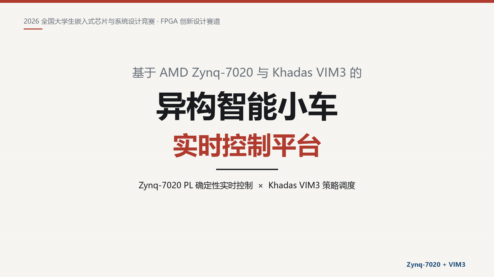

# Zynq-7020 + Khadas VIM3 异构智能小车 · 比赛视频

这是一套参赛展示视频的成片与可复现的剪辑工程，不是 FPGA/MCU 固件仓库。

**成片：** [`video/Zynq7020_VIM3_SmartCar_1080p.mp4`](video/Zynq7020_VIM3_SmartCar_1080p.mp4)



## 硬件平台

- **AMD Zynq-7020 PL**：20 kHz PWM、正交解码、超声计时、硬件急停与时间戳
- **Khadas VIM3**：Amlogic A311D（4×Cortex-A73 + 2×Cortex-A53），5 TOPS NPU，负责策略、调度与交互
- 五路循迹、红外避障、HC-SR04 超声、四驱电机、舵机

## 视频规格

| 项目 | 参数 |
|---|---|
| 时长 | 71.04 s |
| 画幅 | 1920×1080（16:9） |
| 帧率 | 30 fps |
| 编码 | H.264 / AAC |
| 结构 | 标题 → 作品介绍 → 系统分块 → 硬件实物 → 视频展示 → 设计要点 → END |

## 仓库内容

```
.
├─ video/                 最终成片
├─ assets/                标题卡、架构图、硬件卡、END 卡
├─ docs/                  补拍与分镜方案
├─ build_assets.py        Pillow 生成所有卡片与字幕条
├─ build_video.py         FFmpeg 分段渲染与拼接
├─ requirements.txt
└─ source/                原始竖屏素材放置处（不随仓库提交）
```

## 重新生成

1. 安装依赖：

   ```bash
   python -m pip install -r requirements.txt
   ```

2. 把原始竖屏素材放到 `source/实验视频.mp4`，或设置环境变量：

   ```bash
   export SOURCE_VIDEO="/path/to/实验视频.mp4"
   ```

3. 生成卡片与成片：

   ```bash
   python build_assets.py
   python build_video.py
   ```

`build_video.py` 默认调用系统 `ffmpeg`；如果使用 `imageio-ffmpeg` 自带的二进制，可设置：

```bash
export FFMPEG="$(python -c 'import imageio_ffmpeg;print(imageio_ffmpeg.get_ffmpeg_exe())')"
```

## 说明

- 本仓库只包含视频工程，不包含 Zynq RTL、Vivado 工程或 MCU 固件。
- 演示动作来自现有实车素材；硬件照片为实际板卡照片，未使用生成式画面冒充实测。
- 片中没有学校名称、校徽、指导老师姓名等盲审敏感信息。
- 原始竖屏素材不随仓库提交，避免把未必要的原始人物画面公开。
